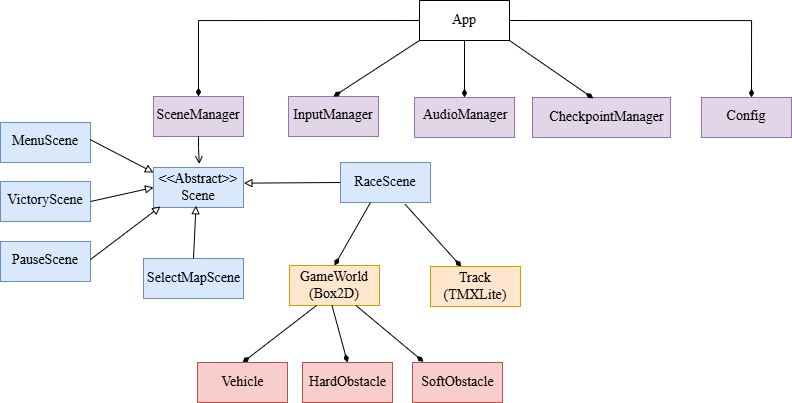

# Overview

Mini Racers is a top-down multiplayer racing game. Two players race against each other on a track, avoiding obstacles and hitting boosters on the way. The first to complete three laps wins the race. The game features local split-screen multiplayer, dynamic vehicle handling, and a robust checkpoint system.

---

# Software Structure

## Overall Architecture

The program is coded in C++ and includes a scene manager, an input manager, a game world manager, and an audio manager.

- **SceneManager** — Displays scenes and switches between them (menu, race, victory, etc.)
- **InputManager** — Processes user inputs and passes commands to scenes
- **RaceScene** — Controls the gameplay loop and updates the display
- **GameWorld** — Handles physics and creates Box2D objects for vehicles and obstacles
- **Vehicle** — Manages movement, acceleration, steering, and collision consequences
- **ObstacleManager / CheckpointManager** — Detect obstacle or checkpoint interactions
- **AssetManager** — Parses TMX maps and loads track, objects, vehicle data
- **HUD, Timer, Cameras** — Display gameplay information and support split-screen
- **AudioManager** — Plays audio using the asset library

---

# Class Relationship Diagrams

## Main Class Relationships Diagram



### Color-Coded Modules

#### Purple (System Management):

- **SceneManager** – Manages scene transitions and lifecycle
- **InputManager** – Handles keyboard input for player controls
- **AudioManager** – Singleton responsible for audio playback
- **CheckpointManager** – Tracks lap progression and race completion
- **Config** – Game settings and constants

#### Blue (Scene Layer):

- **Scene (Abstract)** – Base class for all scenes
- **MenuScene** – Main menu interface
- **VictoryScene** – Race end/winner display
- **PauseScene** – Pause menu
- **SelectMapScene** – Map selection
- **RaceScene** – Core gameplay scene

#### Orange (Game Logic):

- **GameWorld (Box2D)** – Physics simulation engine managing all dynamic bodies
- **Track (TMXLite)** – Map data loaded from Tiled format files

#### Pink (Game Objects):

- **Vehicle** – Player-controlled vehicles with physics bodies
- **HardObstacle** – Static map obstacles (walls, barriers)
- **SoftObstacle** – Dynamic obstacles (oil slicks, boosters)

#### Architecture Flow

- App (Entry point) initializes SceneManager, InputManager, AudioManager, CheckpointManager, and Config.
- All scenes inherit from an abstract scene base class.
- RaceScene contains core gameplay components and manages the GameWorld and Track.
- GameWorld contains all interactive objects and manages vehicles and obstacles using Box2D.
- AudioManager is a Singleton accessed by all scenes and provides global audio access.

---

# Interfaces to External Libraries

## SFML
Purpose: Cross-platform multimedia framework for graphics, audio, and input handling.

#### Audio Module (`sf::Music`, `sf::Sound`)
- **Location:** src/System/AudioManager.hpp/cpp
- **Usage:** Direct audio playback for background music and sound effects
- **Key Functions:**
    - `sf::Music::openFromFile()` - Load and play streaming music
    - `sf::Music::setVolume()` - Control volume (0.0 - 100.0)
    - `sf::Music::play() / stop()` - Control playback
    - `sf::Music::setLoop()` - Enable looping for background music

#### Graphics Module (`sf::Texture`, `sf::Sprite`, `sf::RenderWindow`)
- **Location:** Multiple scene files and rendering code
- **Usage:** Texture loading, sprite rendering, window management
- **Key Classes:**
    - `sf::RenderWindow` - Main display window
    - `sf::Texture` - Image resources for sprites and backgrounds
    - `sf::Sprite` - 2D drawable objects positioned on screen

#### Input Module (`sf::Keyboard`, `sf::Event`)
- **Location:** InputManager.hpp, scene event handlers
- **Usage:** Keyboard input detection and event processing
- **Key Functions:**
    - `sf::Keyboard::isKeyPressed()` - Poll keyboard state
    - `sf::Event` - Event-driven input handling

#### Window Module (`sf::View`)
- **Location:** Camera.cpp, scene rendering
- **Usage:** Split-screen camera management and viewport control

## Box2D
- **Purpose:** 2D rigid body physics simulation for vehicle dynamics and collisions.
- **Location:** src/Gameplay/GameWorld.hpp/cpp, vehicle and obstacle management
- **Key Interfaces:**
    - World Management:
        - `b2CreateWorld()` - Initialize physics world
        - `b2World_Step()` - Simulate physics at fixed timestep
        - `b2World_GetContactEvents()` - Detect collisions
    - Body Creation:
        - `b2BodyDef` - Define body properties
        - `b2CreateBody()` - Add rigid body to world
        - `b2Body_SetTransform()` - Set position and rotation
    - Shapes:
        - `b2ShapeDef` - Shape definition
        - `b2Polygon_Box()` - Rectangular collision shapes
        - `b2Shape_GetUserData()` - Custom data attachment
    - Collision Detection:
        - `b2SensorEvents` - Sensor-based event detection (checkpoints, soft obstacles)
        - `b2ContactEvents` - Contact-based events (vehicle collisions)

## TMXLite
- **Purpose:** Load and render Tiled `.tmx` map files for level design.
- **Location:** src/Race/Track.hpp/cpp, map loading, and object parsing
- **Key Interfaces:**
    - Map Loading:
        - `tmx::Map::load()` - Parse TMX file
        - `tmx::Map::getTilesets()` - Access tileset data
        - `tmx::Map::getLayers()` - Access map layers
    - Object Parsing:
        - `tmx::ObjectGroup` - Container for custom objects
        - `tmx::Object` - Custom map objects (spawn points, obstacles, checkpoints)
    - Properties system 
        - Key-value metadata for objects
    - Rendering:
        - Tile rendering through SFML integration
        - Tileset extraction for dynamic sprite generation

---
# Known issues
## Platform-Specific Audio Behavior

- **Linux/Ubuntu:** Audio system fully functional with hardware audio output
- **WSL (Windows Subsystem for Linux):**
  - **Error:** `ALSA lib pulse.c:242: PulseAudio: Unable to connect: Timeout`
  - **Cause:** WSL lacks audio hardware. SFML attempts PulseAudio connection and times out, causing audio glitches.
  - **Impact:** Intermittent or no audio output during gameplay, but game runs smoothly otherwise. 

## Valgrind Memory Check
- Valgrind output reports no memory leaks. Some memory is reported as still reachable when exit the game which comes from SFML's internal allocations.

# Instructions for Building and Using the Software

## Prerequisites

- CMake 3.22+
- C++20 compiler
- SFML 2.x
- Box2D and TMXLite are included in the repository

---

## Building the Software

### Linux
```bash
sudo apt update
sudo apt install build-essential cmake libsfml-dev
cd micro-machines-1
mkdir build && cd build
cmake ..
make
```

### Windows
```bash
mkdir build
cd build
cmake .. -G "Visual Studio 17 2022" -A x64
cmake --build . --config Release
```

### macOS
```bash
brew install cmake sfml
mkdir build && cd build
cmake ..
make
```

---

## Running the Game

> [!NOTE]
> Make sure to run the executable inside the build folder

### Linux/macOS
```bash
./MicroMachines
```

### Windows
```bash
MicroMachines.exe
```

# How the Game Works

- The game can be played by 2 players with split-screen view. Players complete laps by passing all checkpoints. The first player to finish all required laps (default 2 laps) wins. The game also ends automatically when the timer runs out (default 5 minutes).
- Vehicles collide with each other and map borders. Boost pads speed up vehicles, oil slows them down, and leaving the track reduces speed to approximately 60% of normal driving speed.
- The game includes HUD showing race timers and number of remaining laps for each player, and a dynamic camera that follows each player's car.

---

# Controls

**Menu:**  
Arrow keys to navigate, Enter to select, ESC to go back.

**Player Controls:**  
- Player 1: WASD  
- Player 2: Arrow keys  

**Pause:** ESC  

---

# Technical Details

- Assets including background images, audio, maps are stored in `assets/`  
- Maps can be extended by adding `.tmx` files to `assets/maps/`  

---

# Testing

The project used manual testing by running the game to validate rendering, physics, and logic.  
Before merging major features, another team member tested the branch for regressions.

---

# Work Log

Work across sprints was distributed according to skill areas:

- Vehicle and physics systems – Lam Ho  
- Scene management, UI, and project structure – Linh Vo  
- Build system, audio, and race logic – Linh Bui  
- TMX map content and integration – Stanislaw Piskorski  

We also utilized LLM such as ChatGPT to debug our codes, reorganize project structure, and generate documentation template.

## Sprint 1 — Setup & First Movement (13.10 – 24.10)

### Planned Work
- Set up CMake and integrate SFML and Box2D  
- Add JSON library  
- Load and draw a map  
- Implement basic vehicle movement and collisions  
- Create simple main menu  

### Completed Work

**Linh Bui**
- Project and build setup, including CMake configuration  
- Integrated SFML, Box2D, and JSON libraries  

**Lam Ho**
- Implemented basic vehicle movement  

**Linh Vo**
- Set up scene management system 
- Implemented menu UI components 
- Handle transitions between menu and race scene 

## Sprint 2 — Core Race Loop (27.10 – 07.11)

### Planned Work
- Add a second local player  
- Add soft and hard obstacles and boosters  
- Countdown, checkpoints, finish line, and victory screen  
- HUD for laps and timer  
- Add unit tests  

### Completed Work

**Linh Bui**
- Implemented checkpoint system  
- Implemented lap counting and lap completion validation

**Lam Ho**
- Added second vehicle and second-player controls  
- Implemented soft and hard obstacles, and boosters with collision effects  
- Fixed vehicle update and rendering bugs

**Linh Vo**
- Implemented in-race HUD
- Implemented victory scene and pause scene
- Refactored hard coded player input system


**Stanislaw Piskorski**
- Implemented TMX map loading and rendering
- Adapted Box2D vehicle movements to TMX vehicle objects
- Implemented soft obstacles, boosters, and checkpoint objects in TMX map
- Implemented split screen views

## Sprint 3 — Content & Polish (10.11 – 21.11)

### Planned Work
- Sound effects and music  
- Additional vehicle type  
- Terrain types with handling effects  
- Optional: online play  

### Completed Work

**Linh Bui**
- Implemented audio system for sound effects and background music

**Lam Ho**
- Fine-tuned vehicle movement and physics
- Implemented different specifications for multiple vehicle types
- Merged TMX logic with existing Box2D physics code


**Linh Vo**
- Merged TMX rendering with the existing SFML rendering system
- Added map selection option to the main menu
- Adapted HUD lap display for split-screen
- Added countdown system with input freeze

## Sprint 4 — Stabilize & Submit (24.11 – 05.12)

### Planned Work
- Bug fixes and code cleanup  
- Small performance improvements  
- Write user guide and final report  

### Completed Work

**Linh Bui**
- Contributed to final documentation

**Lam Ho**
- Contributed to final documentation

**Linh Vo**
- Fixed memory leak related to scene switching and game shutdown
- Refactored RaceScene and Track 
- Contributed to final documentation

**Stanislaw Piskorski**
- Implemented map borders in TMX map and integrate collision physics
- Implemented off-track speed
- Contributed to final documentation
